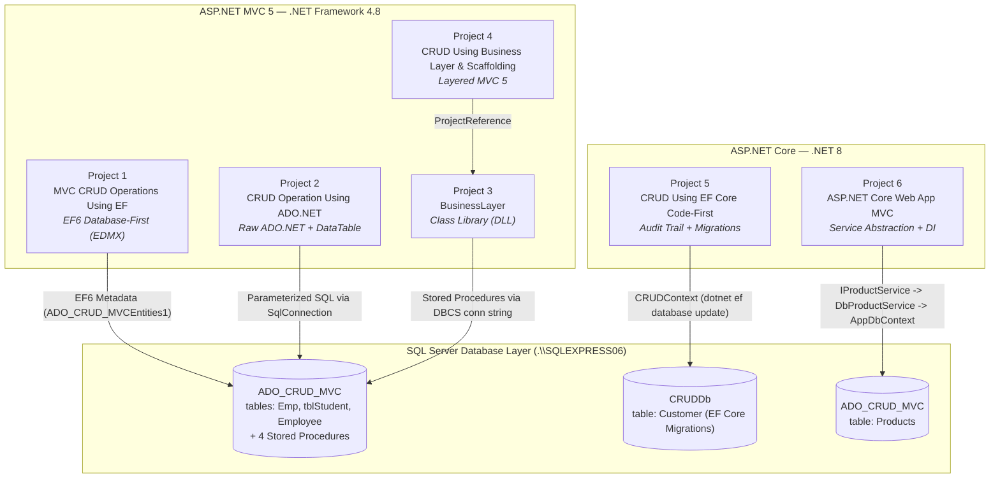

# ASP.NET Data-Access Patterns Evolution Portfolio

This solution is an educational portfolio showcasing the architectural evolution of ASP.NET data-access patterns across six projects spanning from legacy .NET Framework 4.8 (ASP.NET MVC 5) to modern .NET 8 (ASP.NET Core MVC). It systematically demonstrates the progression from imperative, untyped database operations with raw ADO.NET and Database-First Entity Framework 6 (EDMX), through N-Tier layered encapsulation with class libraries, to modern Code-First Entity Framework Core with automated audit tracking and enterprise-grade Dependency Inversion using interface abstractions and IoC containers.

---

## 📚 Projects Overview

| Project | Framework | Data-Access Approach | What It Teaches |
|---|---|---|---|
| **[1. MVC CRUD Operations Using Entity Framework](MVC%20CRUD%20Operations%20Using%20Entity%20Framework/)** | .NET Framework 4.8 (MVC 5) | Entity Framework 6 (Database First, EDMX) | How first-generation ORMs mapped existing database schemas into visual `.edmx` models, generated `DbContext` instances, tracked state changes, and imported stored procedures as C# methods. |
| **[2. CRUD Operation in ASP.NET MVC Using ADO.NET](CRUD%20Operation%20in%20ASP.NET%20MVC%20Using%20ADO.NET/)** | .NET Framework 4.8 (MVC 5) | Raw ADO.NET (`SqlConnection`, `SqlCommand`, `SqlDataAdapter`) | The imperative baseline pattern; highlights the complexities of manual connection lifecycles, parameterized SQL execution, reading untyped `DataTable` rows in Razor views, and manual `FormCollection` parsing. |
| **[3. BusinessLayer](BusinessLayer/)** | .NET Framework 4.8 (Class Library) | ADO.NET with Stored Procedures | How to encapsulate data access and domain logic inside an isolated Class Library (DLL) using `SqlDataReader`, reusable POCOs, and `System.ComponentModel.DataAnnotations` validation attributes. |
| **[4. CRUD Operation in MVC Using Business Layer and Scaffolding](CRUD%20Operation%20in%20MVC%20Using%20Business%20Layer%20and%20Scaffolding/)** | .NET Framework 4.8 (MVC 5) | References `BusinessLayer.dll` | N-Tier architecture; decoupling presentation controllers from SQL commands, relying on compile-time `<ProjectReference>` dependencies, and securing state changes using POST actions with `[ValidateAntiForgeryToken]`. |
| **[5. CRUD Operations In ASP.NET Core Using Entity Framework Core Code First](CRUD%20Operations%20In%20ASP.NET%20Core%20Using%20Entity%20Framework%20Core%20Code%20First/)** | .NET 8 (ASP.NET Core MVC) | EF Core 8 (Code First + Migrations) | Modern domain-first engineering using `BaseEntity` audit inheritance (IP address, UTC timestamps), Fluent API configurations (`CustomerMap`), unified Add/Edit controller actions, and CLI migrations. |
| **[6. ASP.NET Core Web App MVC](ASP.NET%20Core%20Web%20App%20MVC/)** | .NET 8 (ASP.NET Core MVC) | EF Core 8 + Service Pattern + Dependency Injection | Clean Architecture and the Dependency Inversion Principle (DIP); decoupling controllers via interface abstractions (`IProductService`), registering scoped lifetimes in the DI container, and swappable provider implementations. |

---

## 🗺 System Architecture & Connections



---

## 🧭 Learning Path: Recommended Reading Order

To get the most out of this portfolio, read through the projects in the following architectural sequence:

1. **Step 1: The Imperative Baseline — Project 2 (`CRUD Operation in ASP.NET MVC Using ADO.NET`)**
   - *Start here* to understand how web applications originally handled data before ORMs became ubiquitous. Notice the manual connection opening/closing, SQL parameterization to prevent injection, and the lack of type safety when iterating over untyped `DataTable` rows in Razor.
2. **Step 2: Layered Separation of Concerns — Projects 3 & 4 (`BusinessLayer` & `CRUD Operation in MVC...`)**
   - Observe how business logic and database access were moved out of web controllers into a dedicated class library. Notice how Project 4 delegates completely to `BusinessLayer.dll`, how DataAnnotations on POCOs centralize validation rules, and how destructive operations are secured using HTTP POST with Anti-Forgery validation.
3. **Step 3: First-Generation Declarative ORMs — Project 1 (`MVC CRUD Operations Using Entity Framework`)**
   - Discover how EF6 Database-First simplified persistence using an EDMX designer canvas. Examine how database tables and stored procedures are mapped into strongly-typed `DbSet` collections and method imports, while considering the trade-offs of tight controller-to-context coupling.
4. **Step 4: Modern Domain-Driven Code-First — Project 5 (`CRUD Operations In ASP.NET Core Using EF Core...`)**
   - Move into the modern .NET 8 ecosystem. Study Code-First domain modeling, Fluent API constraints (`IEntityTypeConfiguration`), audit entity inheritance (`BaseEntity` tracking UTC dates and client IP addresses), and database evolution via EF Core CLI migrations.
5. **Step 5: Enterprise Dependency Inversion & Clean Architecture — Project 6 (`ASP.NET Core Web App MVC`)**
   - Reach architectural maturity by examining the Dependency Inversion Principle. Observe how `ProductController` knows nothing about EF Core or SQL Server, depending solely on the `IProductService` interface. Compare `DbProductService` with the in-memory `ProductService` to see how IoC container registration (`AddScoped`) enables instant provider switching and effortless unit test mocking.

---

## ⚙️ Prerequisites & Setup

### Environment Requirements
- **Visual Studio 2022** (v17.10 or later recommended for native `.slnx` solution file support).
- **Workloads**: *ASP.NET and web development* & *.NET desktop development*.
- **Targeting Packs & SDKs**:
  - [.NET 8.0 SDK](https://dotnet.microsoft.com/download/dotnet/8.0)
  - [.NET Framework 4.8 Targeting Pack](https://dotnet.microsoft.com/download/dotnet-framework/net48)
- **Database Engine**: Microsoft SQL Server (SQL Server Express, Developer Edition, or LocalDB).

### Database Configuration
Connection strings across the solution are configured with Windows Integrated Authentication and default to:
```
Server=.\SQLEXPRESS06;Integrated Security=True;TrustServerCertificate=True;
```

> [!IMPORTANT]
> **SQL Server Instance Name**: If your local SQL Server instance is named differently (e.g., `.\SQLEXPRESS`, `(localdb)\mssqllocaldb`, or `localhost`), update the connection string's `Data Source=` or `data source=` in:
> - **MVC 5 Web Apps**: `Web.config` (in Projects 1, 2, and 4)
> - **ASP.NET Core Apps**: `appsettings.json` (in Projects 5 and 6)

### Database Initialization

#### 1. Setup `ADO_CRUD_MVC` (Projects 1, 2, 3, 4, 6)
Open SQL Server Management Studio (SSMS) or Azure Data Studio and run the SQL scripts located in the `/database` folder in order:
1. [`database/01_Employee_and_StoredProcedures.sql`](database/01_Employee_and_StoredProcedures.sql): Creates `Employee` table, seed data, and CRUD stored procedures.
2. [`database/02_tblStudent.sql`](database/02_tblStudent.sql): Creates `tblStudent` table.
3. [`database/03_Emp.sql`](database/03_Emp.sql): Creates `Emp` table.
4. [`database/04_Products.sql`](database/04_Products.sql): Creates `Products` table and sample inventory.

#### 2. Setup `CRUDDb` (Project 5)
Apply EF Core Code-First migrations via the .NET CLI:
```powershell
cd "CRUD Operations In ASP.NET Core Using Entity Framework Core Code First"
dotnet ef database update
```

---

## 🚀 Running the Projects

1. Open [`MVC Practice.slnx`](MVC%20Practice.slnx) in Visual Studio 2022.
2. In the **Solution Explorer**, right-click the desired project and choose **Set as Startup Project**.
3. Press **F5** or **Ctrl+F5** to start debugging.
4. Navigate to the primary entry route:
   - **Project 1**: `https://localhost:<port>/Emps/Index`
   - **Project 2**: `https://localhost:<port>/CRUD/Index`
   - **Project 4**: `https://localhost:<port>/Employee/Index`
   - **Project 5**: `https://localhost:<port>/Customer/Index`
   - **Project 6**: `https://localhost:<port>/Product/Index`

---

## 📄 License
This project is licensed under the [MIT License](LICENSE) — authored by Rajat Pandya.
