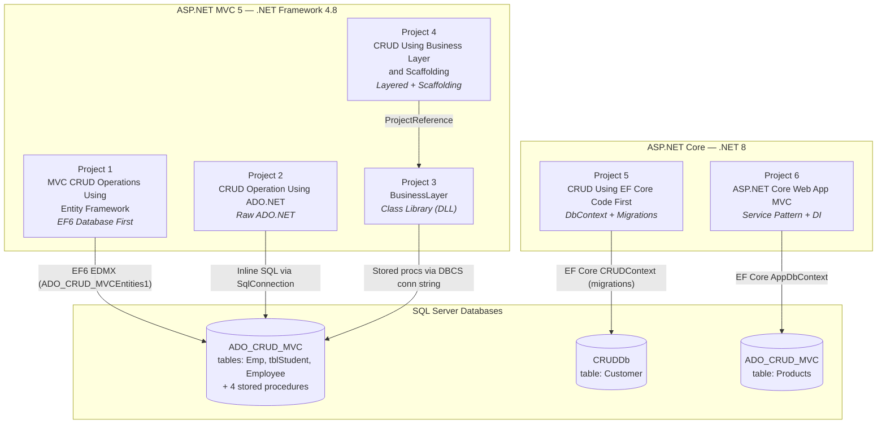
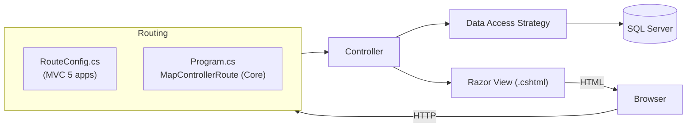
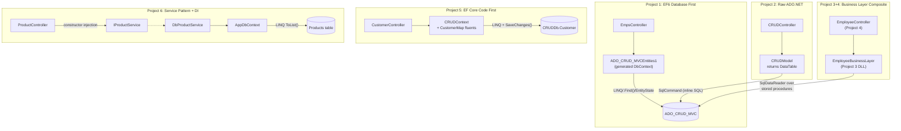
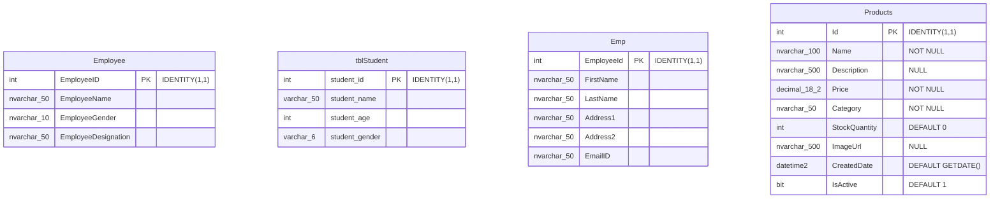
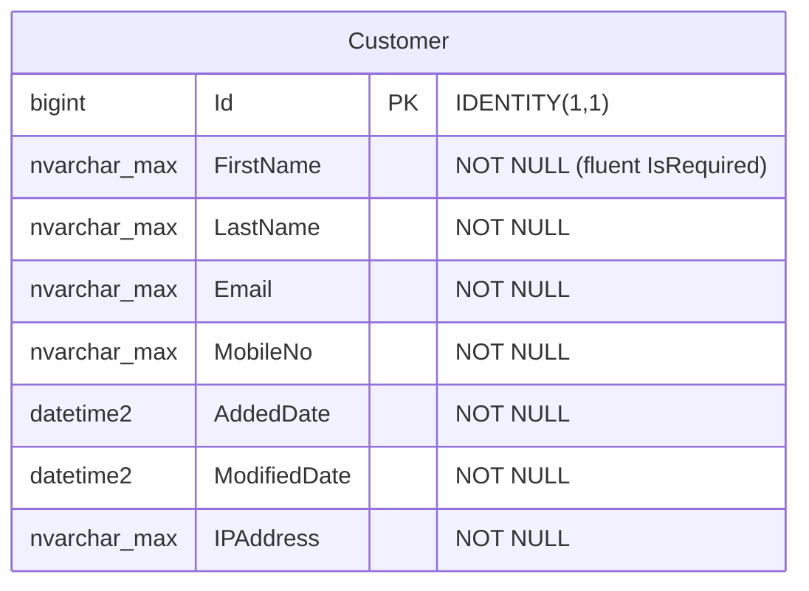
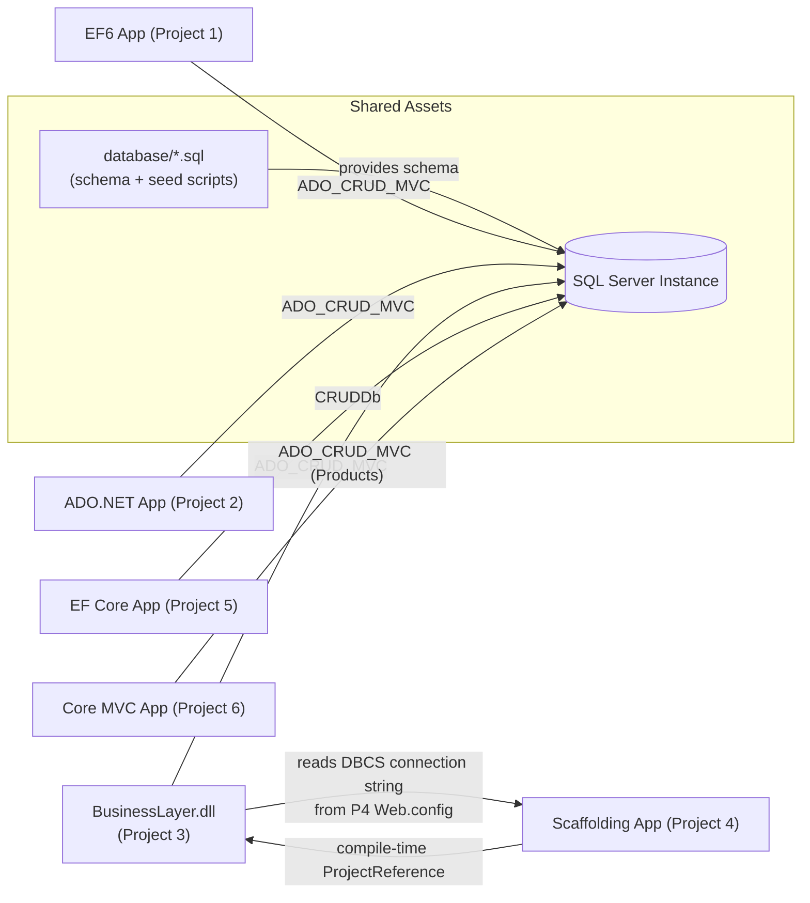

# Context Document — "MVC Practice" Solution

> **Purpose**: This document is written as reference context for AI assistants and developers. It describes the complete structure, architecture, working, and inter-project connections of every project in this solution.

---

## 1. Solution Summary

This is a **learning/practice repository** containing 6 projects that demonstrate the **evolution of ASP.NET MVC data-access patterns** — from raw ADO.NET, through Entity Framework 6 (Database First), to ASP.NET Core 8 with EF Core (Code First) and Dependency Injection.

| # | Project | Type | Runtime | Data Access | Default Route Entry |
|---|---------|------|---------|-------------|---------------------|
| 1 | `MVC CRUD Operations Using Entity Framework` | ASP.NET MVC 5 Web App | .NET Framework 4.8 | EF 6 Database First (EDMX) + Stored Procedures | `Emps/Index` |
| 2 | `CRUD Operation in ASP.NET MVC Using ADO.NET` | ASP.NET MVC 5 Web App | .NET Framework 4.8 | Raw ADO.NET (`SqlConnection`/`DataTable`) | `CRUD/Index` |
| 3 | `BusinessLayer` | Class Library (DLL) | .NET Framework 4.8 | ADO.NET + Stored Procedures | N/A (no UI) |
| 4 | `CRUD Opertation in MVC Using Business Layer and Scaffolding` | ASP.NET MVC 5 Web App | .NET Framework 4.8 | References **BusinessLayer** DLL | `Employee/Index` |
| 5 | `CRUD Operations In ASP.NET Core Using Entity Framework Core Code First` | ASP.NET Core MVC | .NET 8 | EF Core Code First + Migrations | `Customer/Index` |
| 6 | `ASP.NET Core Web App MVC` | ASP.NET Core MVC | .NET 8 | EF Core + Service/Repository Pattern + DI | `Product/Index` |

**Shared database server**: Local SQL Server (`(localdb)\mssqllocaldb` or `.\SQLEXPRESS`).

---

## 2. Solution-Level Architecture

All 6 projects are **independent web applications** (each individually runnable) except `BusinessLayer`, which is a shared class library consumed by Project 4. They do **not** share a process — the connection is **conceptual (pattern evolution)** and **physical (BusinessLayer → Scaffolding project reference)** and **data (shared/local SQL Server databases)**.



> **Note**: Projects 5 and 6 use separate databases — Project 5 targets `CRUDDb`, Project 6 targets the `Products` table in `ADO_CRUD_MVC`.

---

## 3. Request-Handling Architecture Comparison

Every project implements the same **MVC request lifecycle** with a different data-access strategy:



### Data-access strategy per project



---

## 4. Project-by-Project Architecture

### 4.1 — MVC CRUD Operations Using Entity Framework *(EF6 Database First)*

**Namespace**: `MVC_CRUD_Operations_Using_Entity_Framework`

**Structure**:
```
├── Controllers/EmpsController.cs      ← CRUD actions (Index, Details, Create, Edit, Delete)
├── Model1.Context.cs                  ← generated DbContext: ADO_CRUD_MVCEntities1
├── Model1.Designer.cs / Model1.cs     ← EDMX artifacts
├── Emp.cs                             ← entity: Emp (maps to dbo.Emp table)
├── Employee.cs                        ← entity: Employee (maps to dbo.Employee)
├── tblStudent.cs                      ← entity: tblStudent
├── spGetAllEmployees_Result.cs        ← complex-type result of stored procedure
├── App_Start/ (RouteConfig, FilterConfig, BundleConfig)
├── Views/Emps/*.cshtml                ← scaffolded CRUD views
├── Global.asax.cs                     ← app startup (filters, routes, bundles)
└── Web.config                         ← EF6 connection strings below
```

**Working**: Controller instantiates the DbContext directly (`private ADO_CRUD_MVCEntities1 db`), uses `db.Emps.Find(id)`, `db.Emps.Add/Remove`, `EntityState.Modified`, `SaveChanges()`. Views were scaffolded. Each POST is protected with `[ValidateAntiForgeryToken]` and `[Bind(Include=...)]` anti-overposting.

**Connection strings** (`Web.config`): `ADO_CRUD_MVCEntities` and `ADO_CRUD_MVCEntities1` — EF metadata-based (`metadata=res://*/Model1.csdl|...`) pointing at `ADO_CRUD_MVC`.

The generated context also exposes **method mappings** for stored procedures: `spDeleteEmployee`, `spGetAllEmployees`, `spInsertEmployeeDetails`, `spUpdateEmployee` (via `ObjectContext.ExecuteFunction`).

**Default route**: `{controller=Emps}/{action=Index}/{id}`

---

### 4.2 — CRUD Operation in ASP.NET MVC Using ADO.NET *(Raw ADO.NET)*

**Namespace**: `CRUD_Operations_In_ASP.NET_MVC_Using_ADO.NET`

**Structure**:
```
├── Controllers/CRUDController.cs      ← Index, Insert, InsertRecord, Edit, UpdateRecord, Delete
├── Models/CRUDModel.cs                ← all DB logic inline (ADO.NET)
├── Views/CRUD/Home.cshtml, Create.cshtml, Edit.cshtml
├── App_Start/RouteConfig.cs
└── Global.asax.cs
```

**Working**: Controller creates `CRUDModel` per request and passes raw `DataTable` to views. Form values read from `FormCollection` (e.g., `frm["txtName"]`). The model builds necessity-scope connections with connection strings and **inline SQL** (one `Select * from tblStudent where student_id=` concatenated — SQL injection risk in `GetStudentByID`; Insert/Update/Delete are parameterized).

**Educational Context**: This is intentionally the "naïve" baseline pattern — no stored procedures, no config-driven connection strings, no strongly-typed views, no anti-forgery validation.

**Default route**: `{controller=CRUD}/{action=Index}/{id}` — targets `tblStudent` table.

---

### 4.3 — BusinessLayer *(Class Library — shared by Project 4)*

**Namespace**: `BusinessLayer`

**Structure**:
```
├── Employee.cs                ← POCO + DataAnnotations ([Required] on all)
├── EmployeeBusinessLayer.cs   ← full CRUD via stored procedures
├── Properties/AssemblyInfo.cs
└── BusinessLayer.csproj       ← produces BusinessLayer.dll
```

**Working** (this is a pure **Business Logic Layer** — no UI):
- `Employees` property → executes `spGetAllEmployees` through `SqlDataReader` → hydrates `List<Employee>`
- `AddEmployee()` → `spInsertEmployeeDetails`
- `UpdateEmployee()` → `spUpdateEmployee`
- `DeleteEmployee(id)` → `spDeleteEmployee`
- Connection string read via `ConfigurationManager.ConnectionStrings["DBCS"]` (declared in Project 4's `Web.config`).

**Validation**: `Employee` POCO uses `[Required]` DataAnnotations; host project's `ModelState.IsValid` drives validation.

---

### 4.4 — CRUD Opertation in MVC Using Business Layer and Scaffolding *(Layered)*

**Namespace**: `CRUD_Opertation_in_MVC_Using_Business_Layer_and_Scaffolding`

**Structure**:
```
├── Controllers/EmployeeController.cs  ← Index, Create (GET/POST), Edit (GET/POST), Delete, Details
├── Views/Employee/*.cshtml            ← scaffolded strongly-typed views
├── App_Start/RouteConfig.cs
├── Global.asax.cs
├── Web.config                         ← contains "DBCS" connection string (used by BusinessLayer)
└── .csproj                            ← <ProjectReference> → ../BusinessLayer/BusinessLayer.csproj
```

**Working**: Controller instantiates `EmployeeBusinessLayer` per action and never touches database code. Create/Edit posts bind `Employee` model; `ModelState.IsValid` enforces `[Required]` validation defined in the BusinessLayer POCO. Delete action directly deletes (no confirmation view in current code).

**Default route**: `{controller=Employee}/{action=Index}/{id}`

**Connection**: This is the **only cross-project reference** in the solution: *Scaffolding App → BusinessLayer DLL*.

---

### 4.5 — CRUD Operations In ASP.NET Core Using EF Core Code First

**Namespace**: `CRUD_Operations_In_ASP.NET_Core_Using_Entity_Framework_Core_Code_First` (targets `net8.0`)

**Structure**:
```
├── Controllers/HomeController.cs      ← template home/error pages
├── Models/CustomerController.cs       ← actual CRUD controller (lives under Models/ by convention quirk)
├── Models/CustomerViewModel.cs        ← input/validation model ([Required], [EmailAddress])
├── Models/ErrorViewModel.cs
├── DbEntities/CRUDContext.cs          ← DbContext; registers CustomerMap
├── DbEntities/BaseEntity.cs           ← Id, AddedDate, ModifiedDate, IPAddress (audit)
├── DbEntities/Customer.cs             ← entity : BaseEntity
├── DbEntities/CustomerMap.cs          ← fluent mapping (HasKey, IsRequired)
├── Migrations/                        ← MyFirstMigration → creates Customer table
├── Views/Customer/{Index, AddEditCustomer, DeleteCustomer}.cshtml
└── Program.cs                         ← minimal hosting; AddDbContext<CRUDContext>; default route Customer/Index
```

**Working**:
- DI: `builder.Services.AddDbContext<CRUDContext>(options => options.UseSqlServer(...))` — context injected into `CustomerController` ctor.
- **Combined Add+Edit action** (`AddEditCustomer`) — one GET+POST pair handles both create (`id == null`) and update (`id has value`). Saves `IPAddress` from `HttpContext.Connection.RemoteIpAddress` and UTC timestamps.
- Separate GET/POST `DeleteCustomer` (confirmation page then delete).
- Entity-to-ViewModel mapping done manually with LINQ `Select`.
- `[ValidateAntiForgeryToken]` on all POSTs.

**Connection string** (`appsettings.json`): `DefaultConnection` → `CRUDDb` database. Default route: `{controller=Customer}/{action=Index}/{id?}`.

---

### 4.6 — ASP.NET Core Web App MVC *(Service Pattern + DI)*

**Namespace**: `ASP.NET_Core_Web_App_MVC` (targets `net8.0`)

**Structure**:
```
├── Controllers/ProductController.cs   ← Index, Details
├── Controllers/HomeController.cs      ← template pages
├── Models/Product.cs                  ← POCO entity (Id, Name, Description, Price,
│                                        Category, StockQuantity, ImageUrl, CreatedDate, IsActive)
├── Models/IProductService.cs          ← abstraction: GetAllProducts(), GetProductById(id)
├── Models/DbProductService.cs         ← EF implementation of IProductService
├── Models/ProductService.cs           ← alternate/in-memory implementation variant
├── Models/AppDbContext.cs             ← DbContext; Price mapped decimal(18,2) via fluent API
├── Views/Product/{Index, Details}.cshtml
└── Program.cs                         ← DI registrations; default route Product/Index
```

**Working**:
- DI registration: `builder.Services.AddScoped<IProductService, DbProductService>()`
- Controller depends on **interface only** — mockable and swappable (`ProductService.cs` is a non-DB variant).
- Service pattern / clean architecture: Controller → Service abstraction → DbContext.

**Connection string** (`appsettings.json`): `DefaultConnection` → `ADO_CRUD_MVC` database, `Products` table. Default route: `{controller=Product}/{action=Index}/{id?}`.

---

## 5. Full Database Schema

Two databases on SQL Server:

### 5.1 Database `ADO_CRUD_MVC`



Tables have **no foreign-key relationships** (independent demo tables).

**Stored procedures** (created by `Solution Items/Setup_ADO_CRUD_MVC.sql` or `SQLQuery1.sql`, used by Projects 1 & 3):
- `spGetAllEmployees`
- `spInsertEmployeeDetails`
- `spUpdateEmployee`
- `spDeleteEmployee`

### 5.2 Database `CRUDDb`

Table `Customer` — created by EF Core migration (`MyFirstMigration`):



Audit columns (`AddedDate/ModifiedDate/IPAddress`) come from inherited `BaseEntity`.

---

## 6. Inter-Project Connections (Complete Map)


